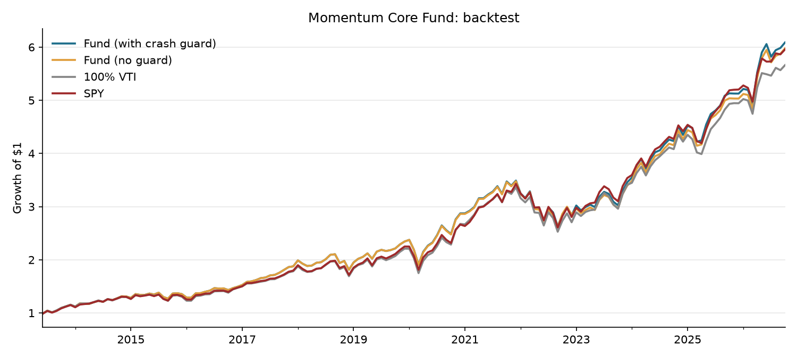

# Momentum Core Fund (paper fund)

A model portfolio built from my [equity factor research](https://github.com/ReelJT/equity-factor-research), tracked publicly from launch with monthly letters. No real outside money is managed. This is a paper fund to build a transparent track record.

## Mandate

Long term US equity fund. Broad market core with a momentum tilt, a small low volatility buffer, and a rule to step out of momentum after market crashes. Benchmark: S&P 500 (SPY).

| ETF | Weight | Role | Why (from my research) |
|---|---|---|---|
| VTI | 60% | Core | Whole US market, keeps the fund close to the benchmark |
| MTUM | 30% | Momentum tilt | Momentum was the only factor that sorted stocks correctly (top quintile 21.4% vs 15.8% a year) |
| USMV | 10% | Drawdown buffer | Low vol lagged on return but cut max drawdown (14% vs 24% for SPY) |

No reversal sleeve: my backtest found no signal in large caps.

## Rules

* **Rebalance** back to target weights quarterly (end of March, June, September, December). Weights drift in between, like a real portfolio.
* **Crash guard.** If SPY closes a month more than 15% below its 12 month high, the momentum sleeve moves into VTI until it recovers. My research showed momentum crashed in 2021 and 2023, right after big selloffs, when beaten down stocks rebounded.
* All decisions use only information available at that month end.
* The 15% threshold was set before testing, not tuned to the data, to avoid overfitting.

## Run it

```bash
pip install -r requirements.txt
python run.py            # backtest + live results
python run.py --refresh  # pull the latest prices
python run.py --demo     # fake data, no internet
```

Outputs in `output/`: backtest summary and chart, monthly returns, and a draft letter each month with the numbers already filled in.

## Monthly routine

1. After each month end, run `python run.py --refresh`
2. Open the new `output/letter_YYYY-MM.md` and write the three commentary sections
3. Commit it to `letters/` and push

## Backtest (hypothetical, June 2013 to September 2026)



| | Fund (with guard) | Fund (no guard) | 100% VTI | SPY |
|---|---|---|---|---|
| CAGR | 14.4% | 14.3% | 13.8% | 14.2% |
| Volatility | 14.4% | 14.3% | 14.7% | 14.3% |
| Sharpe (rf=0) | 1.01 | 1.01 | 0.96 | 1.01 |
| Max drawdown | 24.6% | 24.7% | 24.8% | 23.9% |

**Takeaways**

* **The tilts helped a little.** Compared with holding only VTI, the momentum and low volatility sleeves added about 0.6% a year with slightly lower volatility.
* **No real edge over SPY.** A 0.2% annual difference is within noise.
* **The crash guard rarely mattered.** It was on in only 6 of 161 months and added about 0.1% a year. It helped in 2023 but missed 2021, when momentum lagged SPY by 7 points before the signal triggered.
* **USMV didn't reduce drawdowns** at the portfolio level, despite cutting drawdowns in my stock level research. A 10% sleeve may be too small to matter.

**What I'm watching live:** whether momentum keeps adding value over VTI, and whether the crash guard earns its place or should be dropped for simplicity.

## Limitations

* The backtest is hypothetical and starts in 2013 because MTUM launched that year.
* ETF returns already include fees, but not taxes or trading costs.
* The crash guard has only triggered a handful of times in this period, so its value is uncertain.

## Live performance

Launched October 6, 2026 with a $100,000 paper value. See `letters/` for monthly updates.
